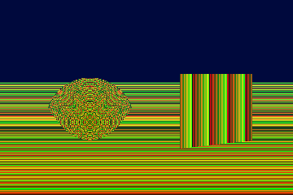
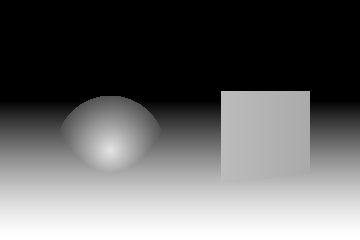
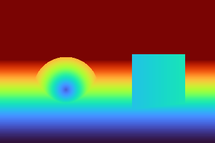

# depth-to-gray

> [!CAUTION]
> # ⚠️ THIS PROJECT IS VIBE CODED ⚠️
>
> **This code was written by an AI (Claude) from a one-sentence request.** Nobody has reviewed it line by line.
> It was only tested on **synthetic, generated images**, not on real depth maps from real software.
>
> - It may give wrong results for your files without any error message.
> - It has **no** unit tests, no CI, and no guarantees.
> - **Check the output yourself** before using it for anything that matters.
>
> Use at your own risk. Issues and fixes are welcome (at least until I lose access to Claude), but don't expect support.

---

A small Python script that turns a "weird colored" 24-bit depth map into a normal black and white (grayscale) depth map.

| Colored input | Grayscale output |
|---|---|
|  |  |
|  |  |

*Top: depth packed into the R/G/B bytes. Bottom: depth painted with the turbo colormap. Both inputs are synthetic.*

## What kinds of colored depth maps?

1. **Packed 24-bit depth (default, `--mode packed`)**
   The depth is one 24-bit number split across the three color bytes, e.g. `depth = R + G*256 + B*65536`.
   These images look like noisy rainbow stripes. Simulators and game engines such as CARLA and Unity produce them.
   The script guesses which channel holds the most significant byte (the smoothest channel). You can override the guess with `--order rgb` (R is high) or `--order bgr` (B is high, as in CARLA).

2. **Colormapped depth (`--mode colormap`)**
   The depth was drawn with a color palette such as turbo or jet, so it looks like a smooth heat map.
   Each pixel is matched to the nearest color in the palette. Choose the palette with `--cmap` (turbo, jet, inferno, magma, plasma, viridis, hot, rainbow).
   This only gives 256 depth levels and only works if you pick the same palette that made the image.

## Install

Requires Python 3.8+.

```bash
pip install -r requirements.txt
```

## Usage

```bash
python depth_to_gray.py depth.png                  # -> depth_gray.png
python depth_to_gray.py depth.png -o out.png
python depth_to_gray.py some_folder/               # converts every image in the folder
python depth_to_gray.py depth.png --order bgr      # force byte order
python depth_to_gray.py depth.png --mode colormap --cmap jet
python depth_to_gray.py depth.png --16bit          # 16-bit PNG, more precision
python depth_to_gray.py depth.png --clip 1         # ignore the 1% extremes (e.g. sky)
python depth_to_gray.py depth.png --invert         # near = black, far = white
```

| Option | What it does |
|---|---|
| `-o, --output` | Output file, or output folder if the input is a folder. Default: `<name>_gray.png` next to the input. |
| `--mode packed\|colormap` | Which kind of colored depth map it is. Default: `packed`. |
| `--order auto\|rgb\|bgr` | Packed mode: which channel is the most significant byte. Default: `auto`. |
| `--cmap NAME` | Colormap mode: the palette that made the image. Default: `turbo`. |
| `--invert` | Output near = black, far = white. The default is near = white, far = black. |
| `--clip PERCENT` | Ignore this percentage of the lowest and highest values when stretching the contrast. |
| `--16bit` | Save a 16-bit PNG instead of 8-bit. |

## Troubleshooting

- **The output is still stripy or scrambled.** The byte order guess was probably wrong. Try `--order rgb` or `--order bgr`. If the input is a smooth rainbow rather than noisy stripes, use `--mode colormap`.
- **Near and far are the wrong way round.** Add `--invert`. Colormapped images don't record which end of the palette means "near", so this can happen in colormap mode.
- **Everything is one flat shade except a few areas.** Something like the sky is at maximum depth and takes up the whole range. Try `--clip 1`.
- **The output looks blocky or banded.** Use `--16bit`. In colormap mode, banding is expected because the palette only has 256 colors.

## How it works

- **Packed mode** rebuilds the 24-bit integer from the three bytes, stretches it to the full 0 to 255 (or 0 to 65535) range, and flips it so near is white.
- **Colormap mode** rebuilds the palette's 256 colors with OpenCV and maps each pixel to the index of the closest one.

The output is **relative** depth: it is stretched to fill the range, so the gray values are not meters.

## License

MIT, see [LICENSE](LICENSE). Provided as is, with no warranty. See the warning at the top.
